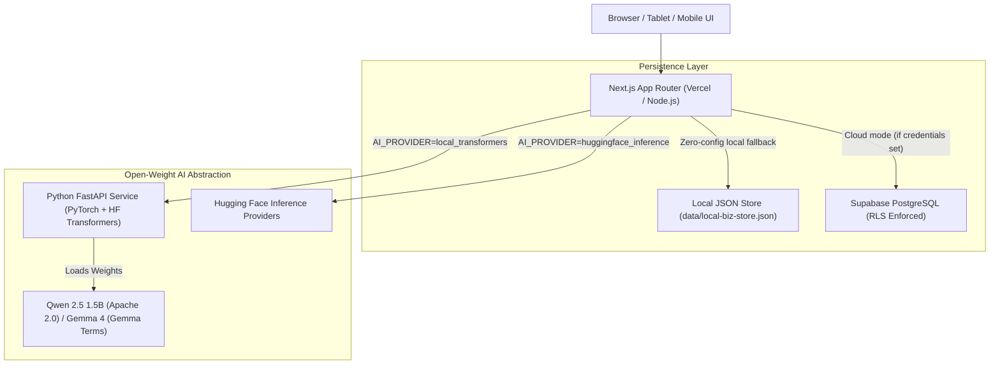

# LocalBiz Copilot — Deployment & Operations Guide

This guide covers deployment procedures for **LocalBiz Copilot**, including the Next.js frontend, the Python FastAPI Transformers inference microservice, and database persistence options.

---

## Architecture Overview



---

## 1. Local Development Setup

### Prerequisites
- Node.js 18+ (Node.js 20+ recommended; verified on Node v25.9)
- Python 3.11+
- `uv` (recommended) or standard `pip`

### Step 1: Install Frontend Dependencies
```bash
npm install
```

### Step 2: Set Up Python AI Inference Microservice
```bash
# Create Python 3.11 virtual environment using uv
uv venv ai_service/.venv --python 3.11

# Install PyTorch, Transformers, FastAPI, and Pydantic
uv pip install -r ai_service/requirements.txt --python ai_service/.venv/Scripts/python.exe

# On Linux/macOS:
# source ai_service/.venv/bin/activate && pip install -r ai_service/requirements.txt
```

### Step 3: Run Both Services
In Terminal 1 (AI Service):
```bash
# Windows:
.\ai_service\.venv\Scripts\uvicorn.exe ai_service.main:app --host 127.0.0.1 --port 8000

# macOS / Linux:
source ai_service/.venv/bin/activate
uvicorn ai_service.main:app --host 127.0.0.1 --port 8000
```

In Terminal 2 (Next.js Frontend):
```bash
npm run dev
```

Open `http://localhost:3000` in your browser. The application runs immediately with realistic artisan bakery sample data without needing external cloud credentials.

---

## 2. Frontend Deployment (Vercel)

The Next.js application is engineered for deployment on [Vercel](https://vercel.com):

1. Push your repository to GitHub.
2. Import the project into your Vercel Dashboard.
3. Framework preset will automatically detect **Next.js**.
4. Configure Environment Variables in the Vercel Project Settings:
   - `AI_PROVIDER`: Set to `huggingface_inference` (if using Hugging Face serverless) or point `AI_SERVICE_URL` to your remote FastAPI endpoint.
   - `AI_MODEL_ID`: `Qwen/Qwen2.5-1.5B-Instruct`
   - `HF_TOKEN`: `hf_...` (Never expose in frontend code)
   - `SUPABASE_URL`: (Optional) Your Supabase project URL.
   - `SUPABASE_ANON_KEY`: (Optional) Your Supabase anon key.
   - `SUPABASE_SERVICE_ROLE_KEY`: (Optional) Your Supabase service role key for server operations.
5. Deploy.

> [!NOTE]
> Vercel runs in a serverless environment and cannot connect directly to `http://localhost:8000` running on your laptop. For hosted demos, either configure `AI_PROVIDER=huggingface_inference` with a valid `HF_TOKEN`, or deploy the FastAPI inference service to a publicly reachable container host.

---

## 3. Inference Service Deployment

### Option A: Serverless via Hugging Face Inference Providers (Easiest)
- Set `AI_PROVIDER=huggingface_inference`
- Set `HF_TOKEN=hf_your_token_here`
- No dedicated Python server required. The Next.js route handlers communicate directly with Hugging Face's hosted inference infrastructure using server-side credentials.

### Option B: Dedicated Container Host (Railway / Render / Fly.io / RunPod)
Create a `Dockerfile` for the Python service:

```dockerfile
FROM python:3.11-slim

WORKDIR /app
COPY ai_service/requirements.txt .
RUN pip install --no-cache-dir -r requirements.txt

COPY ai_service ./ai_service
ENV AI_MODEL_ID="Qwen/Qwen2.5-1.5B-Instruct"
ENV AI_DEVICE="cpu"

EXPOSE 8000
CMD ["uvicorn", "ai_service.main:app", "--host", "0.0.0.0", "--port", "8000"]
```

Deploy the container and set `AI_SERVICE_URL=https://your-ai-service.up.railway.app` in your Vercel dashboard.

---

## 4. Database Setup (Supabase PostgreSQL)

If you wish to use Supabase instead of local JSON storage:

1. Create a project at [supabase.com](https://supabase.com).
2. Open the **SQL Editor** in the Supabase Dashboard.
3. Paste the contents of `schema.sql` located in this repository and run the script.
   - Creates `products`, `sale_transactions`, `brand_profiles`, `daily_briefings`, and `marketing_history` tables.
   - Enables Row Level Security (RLS).
   - Generates indexes for fast queries.
4. Copy `Project URL` and `anon public` key to `.env.local`:
   ```bash
   SUPABASE_URL=https://your-project-id.supabase.co
   SUPABASE_ANON_KEY=your-anon-key
   ```
5. Restart your Next.js application. The app will detect the credentials and switch to `supabase` mode automatically.

---

## 5. Troubleshooting & Diagnostics

| Symptom | Cause | Solution |
| :--- | :--- | :--- |
| `Local Python inference service is offline` | FastAPI is not running on port 8000 | Run `uvicorn ai_service.main:app --port 8000` in your Python environment. |
| `503 Model is currently loading on Hugging Face` | HF cold start for un-cached checkpoint | Wait 30 seconds and retry the request. |
| `Inference timed out after 120 seconds` | CPU generation took too long | Switch to a smaller model checkpoint like `Qwen/Qwen2.5-1.5B-Instruct` or increase `AI_TIMEOUT_SECONDS=180`. |
| `Unrecorded Costs warning on Gross Margin` | Products sold lack unit cost | Edit products in `/inventory` to input known ingredient/packaging unit costs. |
