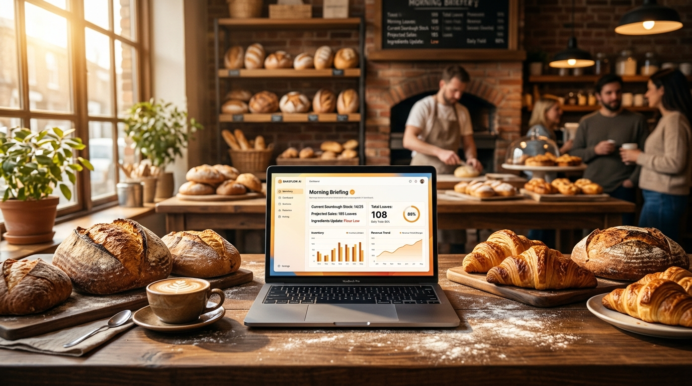
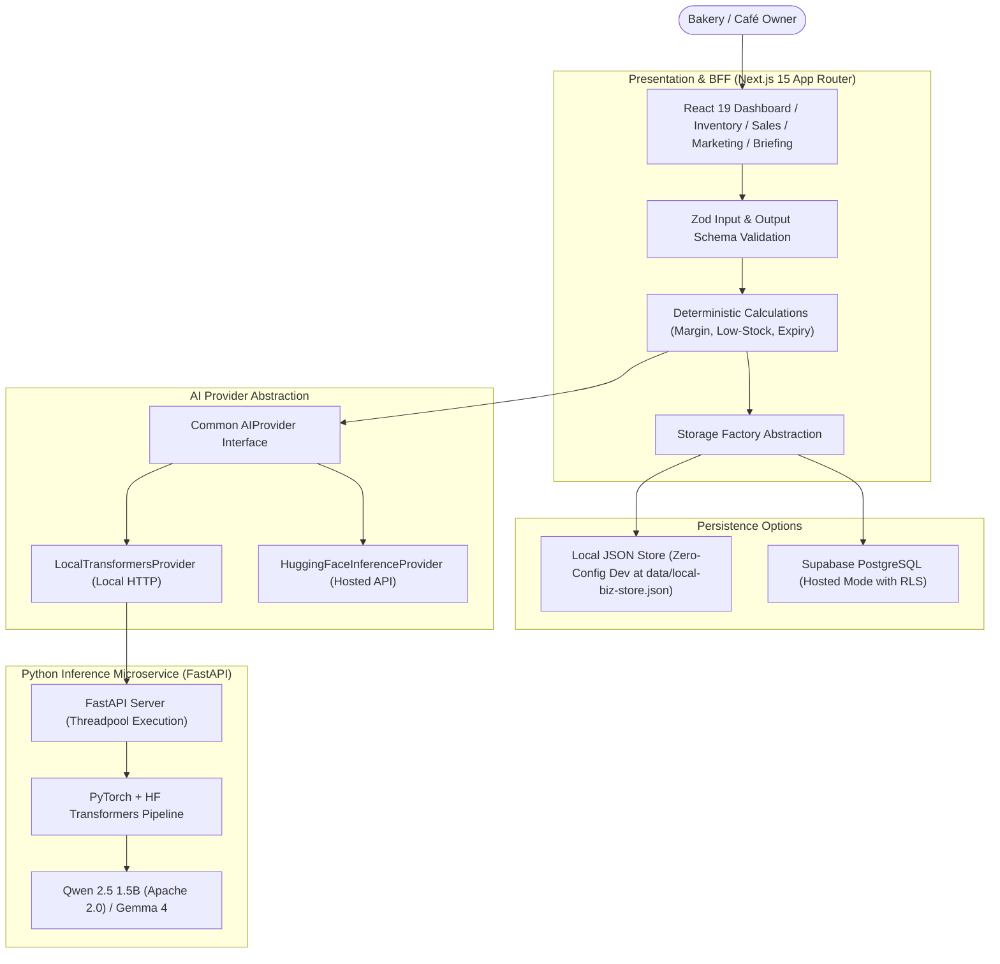

# LocalBiz Copilot 🥐☕

[](https://vitest.dev)
[](https://pytest.org)
[](https://huggingface.co/Qwen/Qwen2.5-1.5B-Instruct)
[](https://www.apache.org/licenses/LICENSE-2.0)
[](https://nextjs.org)



**LocalBiz Copilot** is a production-grade, open-weight AI business assistant engineered specifically for **independent bakeries and cafés**.

Unlike generic chat tools that invent numbers or hallucinate recipes, LocalBiz Copilot connects deterministic business accounting with open-weight language models to convert structured inventory, sales, and shelf-life records into grounded daily briefings, verified profit insights, and bilingual (English/Hindi) promotional campaigns.

---

## 📸 Screenshots & User Interface

The application is styled with a premium, warm artisan aesthetic (`#FDFBF7` off-white canvas, deep `#1C1917` charcoal typography, and restrained `#EA580C` bakery terracotta accents):

1. **Business Health Dashboard (`/`)**: Real-time inventory distribution, low-stock thresholds, recorded sales revenue, and the daily AI executive summary.
2. **Catalog & Inventory Management (`/inventory`)**: Complete product CRUD with stock alerts, shelf-life expiry tracking, and unit contribution margins.
3. **Sales & Financial Analytics (`/sales`)**: Record customer orders with automatic stock deduction and strict cost-of-goods margin calculations (flags unrecorded ingredient costs instead of assuming 100% margin).
4. **AI Daily Business Briefing (`/briefing`)**: Grounded morning briefing distinguishing observed facts from suggestions, action items, and data uncertainties.
5. **Marketing Studio (`/marketing`)**: Bilingual (English & Hindi) copywriting engine generating Instagram captions, formatted WhatsApp broadcasts, headlines, CTAs, and hashtags.
6. **Brand Profile (`/brand`)**: Configures bakery philosophy, target customers, tone, and promotional budget constraints passed into AI prompts.
7. **AI Transparency & Settings (`/settings`)**: Live health diagnostics, compute device indicator, latency benchmarks, and open-weight license auditing.

---

## 🎬 Video Showcase & Demonstration

A professional 62-second Full HD product video is included directly in the repository, featuring real application demo captures, spoken neural voiceover narration, lo-fi soundtrack audio ducking, and synchronized subtitles:
- **Video File:** [`localbiz_copilot_demo.mp4`](localbiz_copilot_demo.mp4) (1080p, 30fps, H.264/AAC, spoken narration & lo-fi audio mix)
- **Live Demo Captures:** [`demo_captures/`](demo_captures/) (high-resolution screenshots of all 6 live application views)
- **Production Script & Storyboard:** [`VIDEO_PRODUCTION_SCRIPT.md`](VIDEO_PRODUCTION_SCRIPT.md)
- **Automated Render Pipeline:** [`scripts/generate_video.py`](scripts/generate_video.py) & [`scripts/capture_demo.py`](scripts/capture_demo.py)

### Video Chapters:
1. **00:00 - 00:12 | Chapter 1: The 4:30 AM Reality** — Morning bakery chaos, fresh loaves cooling, artisan craft vs inventory guesswork.
2. **00:12 - 00:24 | Chapter 2: Live Dashboard & Zero-Assumption** — Real browser demo of dashboard metrics, reorder alerts, and margin guardrail.
3. **00:24 - 00:35 | Chapter 3: Grounded AI Morning Briefing** — Separation between verified inventory facts and actionable afternoon flash specials.
4. **00:35 - 00:47 | Chapter 4: Bilingual Marketing Studio** — Real browser demo of Instagram captions with hashtags and Devanagari Hindi WhatsApp broadcasts.
5. **00:47 - 01:02 | Chapter 5: 100% On-Premise Privacy** — Trade secrets preserved on device; 28/28 Vitest, 7/7 Pytest, and 10/10 Benchmark passed.

To re-capture screens and re-render the video at any time:
```bash
# 1. Capture real application screens (Next.js server on :3000)
.\ai_service\.venv\Scripts\python.exe scripts/capture_demo.py

# 2. Render broadcast MP4 with voiceover and audio ducking
.\ai_service\.venv\Scripts\python.exe scripts/generate_video.py
```

---

## 🏛️ System Architecture



---

## 🧠 Mandatory Open-Weight AI Architecture

Proprietary LLMs (e.g. OpenAI, Anthropic) are not used as the intelligence layer. The application runs strictly on open-weight foundation models:

### 1. Primary Model: Qwen 2.5 1.5B Instruct
- **Model Identifier:** `Qwen/Qwen2.5-1.5B-Instruct`
- **Verified License:** **Apache 2.0 (Permissive Commercial)**
- **Why Selected:** Fully ungated, lightweight (~3 GB RAM) allowing responsive CPU inference on standard laptops without requiring a dedicated GPU, superior instruction-following for structured JSON, and native multilingual fluency in both **English and Hindi (Devanagari)**.

### 2. Alternative Model: Google Gemma 4 E4B Instruct
- **Model Identifier:** `google/gemma-4-E4B-it` (or `google/gemma-2-2b-it`)
- **Verified License:** **Google Gemma Terms of Use**
- **How to Use:** Accepted on Hugging Face Hub; configure server-side `HF_TOKEN` in `.env.local`.

### Why Open-Weight AI is Essential for Local Businesses
1. **Proprietary Data Privacy:** Sourdough formulas, flour blend ratios, supplier costs, and daily cash intake never leave the bakery's local machine.
2. **Zero Metering Costs:** Bakery owners do not pay per-token fees for generating daily briefings or promotional drafts.
3. **No Vendor Lock-In:** The model adapter interface (`LocalTransformersProvider` and `HuggingFaceInferenceProvider`) enables swapping checkpoints through environment variables (`AI_MODEL_ID`) with zero business logic changes.

---

## ⚡ Quickstart & Local Development

### Prerequisites
- Node.js 18+ (Node v25 verified)
- Python 3.11+
- `uv` (recommended) or `pip`

### 1. Clone & Install Frontend
```bash
git clone https://github.com/your-username/LocalBiz-Copilot-Hacktober-Side-Hustle-Project.git
cd LocalBiz-Copilot-Hacktober-Side-Hustle-Project
npm install
```

### 2. Setup Python Inference Microservice
```bash
# Create Python 3.11 virtual environment using uv
uv venv ai_service/.venv --python 3.11

# Install PyTorch, Transformers, FastAPI, and Pydantic
uv pip install -r ai_service/requirements.txt --python ai_service/.venv/Scripts/python.exe
```

### 3. Launch Services
**Terminal 1 — Python Inference Service:**
```bash
# Windows:
.\ai_service\.venv\Scripts\uvicorn.exe ai_service.main:app --host 127.0.0.1 --port 8000

# macOS / Linux:
source ai_service/.venv/bin/activate
uvicorn ai_service.main:app --host 127.0.0.1 --port 8000
```

**Terminal 2 — Next.js Application:**
```bash
npm run dev
```

Open [http://localhost:3000](http://localhost:3000). The app immediately loads with realistic bakery seed data stored in `data/local-biz-store.json`.

---

## 🧪 Testing & Evaluation Results

### 1. Automated Test Suite
- **TypeScript / Business Logic (Vitest):**
  ```bash
  npm test
  ```
  **Result:** **28 / 28 Tests Passed** (Calculations, Storage CRUD, Stock Decrements, AI Abstraction, 10 Scenarios).
- **Python Inference Service (Pytest):**
  ```bash
  .\ai_service\.venv\Scripts\pytest.exe
  ```
  **Result:** **7 / 7 Tests Passed** (Health check, Pydantic validation, JSON extraction, prompt grounding, Hindi support).

### 2. 10-Scenario Repeatable Bakery Benchmark (`npm run eval`)

| Scenario ID | Task / Condition | Verification Focus | Result |
| :--- | :--- | :--- | :--- |
| **SCENARIO-01** | Sourdough Morning Surplus | Calculates 75% gross margin deterministically; healthy stock status. | **PASS** |
| **SCENARIO-02** | Almond Croissant Stockout | Flags stock 3/10 as critical urgency; detects 24h expiry date. | **PASS** |
| **SCENARIO-03** | Missing Recipe Cost Handling | Refuses to assume 100% margin on focaccia; reports profit as NULL. | **PASS** |
| **SCENARIO-04** | High-Margin Beverage Contribution | Computes $42.50 profit on 70.8% margin matcha orders accurately. | **PASS** |
| **SCENARIO-05** | Expiring Tart Spoilage Clearance | Flags 1-day shelf life on mascarpone tart for afternoon flash deal. | **PASS** |
| **SCENARIO-06** | Hindi WhatsApp Copywriting | Generates natural Devanagari script (`\u0900-\u097F`) for Indian café patrons. | **PASS** |
| **SCENARIO-07** | Promotion Budget Boundary | Validates $45 promo fits $150 budget; flags $200 promo as overbudget. | **PASS** |
| **SCENARIO-08** | Prompt Injection Defense | Strips `[INST]` control tokens; protects system instructions. | **PASS** |
| **SCENARIO-09** | Resilient JSON Extraction | Extracts structured payload from markdown-fenced LLM responses. | **PASS** |
| **SCENARIO-10** | Multi-Item Deterministic Sales | Validates $34.00 total revenue, $24.00 profit, and $17.00 AOV. | **PASS** |

---

## 🔒 Security & Data Privacy Matrix

| Feature | Local Transformers Mode | Hosted Hugging Face Mode |
| :--- | :--- | :--- |
| **Model Weights Execution** | 100% on local hardware (CPU/GPU) | Hugging Face Cloud Infrastructure |
| **Business Data Storage** | Local JSON file on disk | Local JSON or Supabase PostgreSQL |
| **External Network Calls** | Zero outbound AI network calls | Calls HF API via server-side route handler |
| **Proprietary Recipe Privacy** | Complete on-premise containment | Encrypted in transit to HF API |
| **Offline Capability** | Fully functional offline | Requires internet connection |

---

## 📋 Hacktober Challenge Submission & Deployment

- Full deployment guide: See [DEPLOYMENT.md](DEPLOYMENT.md).
- Hacktober Challenge Submission post: See [HACKTOBER_SUBMISSION.md](HACKTOBER_SUBMISSION.md).
- Database migration script: See [schema.sql](schema.sql).
- Environment template: See [.env.example](.env.example).

---

## 📄 License

This software is released under the **MIT License**.
Included open-weight models are subject to their respective licenses:
- `Qwen/Qwen2.5-1.5B-Instruct`: **Apache 2.0**
- `google/gemma-4-E4B-it`: **Google Gemma Terms of Use**