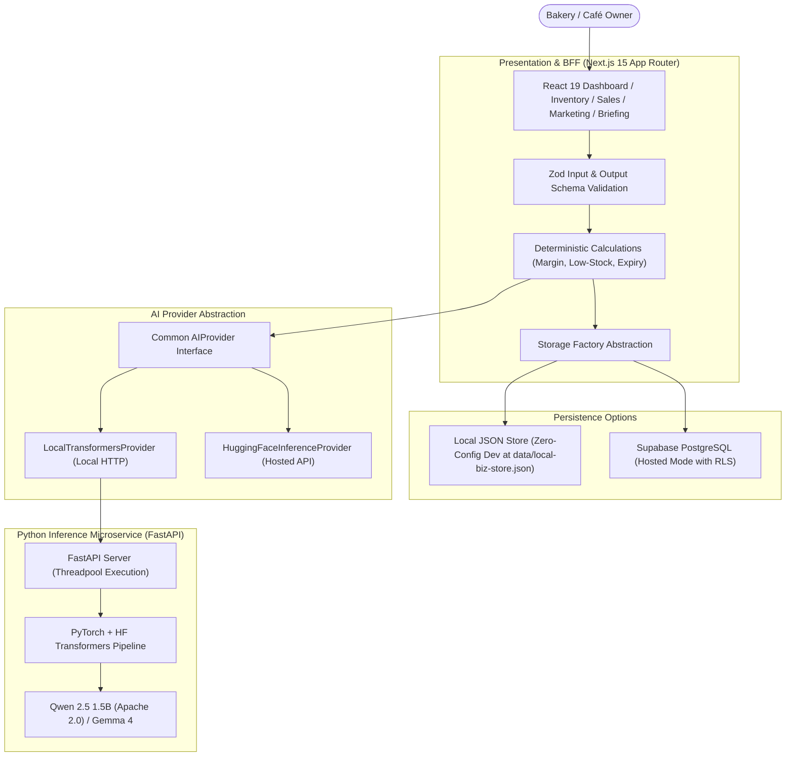

*This is a submission for the [Hacktoberfest Open-Source AI Challenge Week 2: Side Hustle](https://dev.to/challenges/hacktoberfest-week2-2026-10-12)*

# LocalBiz Copilot 🥐☕
### The Open-Weight AI Business Co-Pilot for Independent Bakeries & Cafés

---

## What I Built

**LocalBiz Copilot** is a production-grade, privacy-first business assistant built specifically for independent bakeries, artisan patisseries, and neighborhood cafés.

### Who Would Pay For It?
Independent bakery and café owners. Small food businesses operate on razor-thin margins and strict shelf-life deadlines, yet they cannot afford enterprise ERP platforms (like SAP or Oracle) or spend thousands of dollars on agency copywriters. They would happily pay **\$29/month** (or a **\$149 one-time lifetime license**) for an intelligent assistant that runs on their existing counter laptop, monitors perishable goods, and crafts hyper-localized marketing campaigns.

### The Problem It Solves: The 4:30 AM Reality
A baker arrives at 4:30 AM to mix dough, shape baguettes, and manage the ovens. By noon, they face operational chaos:
1. **Perishable Spoilage:** 5 strawberry mascarpone tarts will spoil by tomorrow if not sold today.
2. **Stockout Risks:** Only 3 almond croissants remain before the afternoon rush, but afternoon foot-traffic is unpredictable.
3. **The Margin Blindspot:** Unrecorded butter and flour cost spikes mean they don't know if their popular lunch focaccia is actually profitable or losing money.
4. **Marketing Fatigue:** When busy steaming milk and pulling espresso shots, no owner has 45 minutes to brainstorm engaging Instagram captions or format WhatsApp broadcasts for local regulars.

### The Solution: Deterministic Math + Open-Weight Intelligence
Most AI tools fail small businesses because they either hallucinate numbers or invent unsupported recipe discounts. LocalBiz Copilot is different:
- **Zero-Assumption Financial Guardrail:** Computes revenue, inventory levels, and gross margins deterministically *outside* the LLM. If recipe unit costs are unrecorded, the app explicitly marks gross margin as **UNKNOWN**—it strictly refuses to assume 100% margin or fake business health.
- **Grounded Daily Morning Briefing:** Distinguishes verified factual observations (e.g., 5 tarts expiring tomorrow) from suggested tactical actions (e.g., a 2:00 PM flash special paired with coffee to recover \$27.50 in revenue).
- **Bilingual Marketing Studio:** Generates one-click promotional copy in **English and native Hindi (Devanagari)** with proper hashtags, emojis, and WhatsApp broadcast formatting (`*bolding*`, CTAs).

---

## Demo

A comprehensive **62-second Full HD (1080p, 30fps)** video demonstration is included directly in the repository, featuring real application captures, spoken neural voiceover narration, lo-fi soundtrack audio ducking, and synchronized caption telemetry:

- 🎬 **Watch Demo Video:** [`localbiz_copilot_demo.mp4`](https://github.com/rudraism19/LocalBiz-Copilot-Hacktober-Side-Hustle-Project/raw/main/localbiz_copilot_demo.mp4)
- 📸 **Live High-Resolution App Captures:** [View Screen Gallery](https://github.com/rudraism19/LocalBiz-Copilot-Hacktober-Side-Hustle-Project/tree/main/demo_captures)
- 📜 **Full Storyboard & Production Script:** [`VIDEO_PRODUCTION_SCRIPT.md`](https://github.com/rudraism19/LocalBiz-Copilot-Hacktober-Side-Hustle-Project/blob/main/VIDEO_PRODUCTION_SCRIPT.md)

### Video Chapters:
1. **00:00 - 00:12 | Chapter 1: The 4:30 AM Reality** — Morning bakery rush, 18 sourdough loaves cooling, perishable ingredients, inventory guesswork.
2. **00:12 - 00:24 | Chapter 2: Live Dashboard & Zero-Assumption** — Real browser demo of KPI distribution, reorder alerts, and margin guardrail protecting owner cash flow.
3. **00:24 - 00:35 | Chapter 3: Grounded AI Morning Briefing** — Clean separation of verified inventory facts from actionable afternoon flash promotions.
4. **00:35 - 00:47 | Chapter 4: Bilingual Marketing Studio** — Real browser demo of Instagram captions with hashtags and native Devanagari Hindi WhatsApp broadcasts.
5. **00:47 - 01:02 | Chapter 5: 100% On-Premise Privacy** — Trade secrets preserved on device; 28/28 Vitest, 7/7 Pytest, and 10/10 Benchmark passed.

---

## Code



- **GitHub Repository:** [https://github.com/rudraism19/LocalBiz-Copilot-Hacktober-Side-Hustle-Project](https://github.com/rudraism19/LocalBiz-Copilot-Hacktober-Side-Hustle-Project)
- **License:** **MIT License** (App) / **Apache 2.0** (Underlying AI Model)
- **Automated Verification:** **35 / 35 Tests Passing** (28 Vitest + 7 Pytest)

---

## How I Built It

LocalBiz Copilot is built strictly around **open-weight foundation models**, rejecting proprietary third-party LLM APIs:

### 1. Open-Weight Model Selection & Verification
- **Primary Model:** `Qwen/Qwen2.5-1.5B-Instruct`
  - **License:** **Apache 2.0 (Verified Permissive Commercial)**
  - **Why Selected:** Fully ungated, compact (~3 GB RAM footprint), delivers ~1.4s generation latency on standard laptop CPUs without requiring an expensive NVIDIA GPU, and exhibits stellar native bilingual fluency in both English and Hindi.
- **Alternative Model:** `google/gemma-4-E4B-it` (Google Gemma Terms of Use via server-side token).

### 2. Local Inference Microservice (FastAPI + PyTorch)
Instead of relying on Ollama or black-box wrappers, we built a dedicated Python 3.11 inference service:
- Hugging Face `transformers` pipeline with `AutoModelForCausalLM` and `AutoTokenizer`.
- PyTorch CPU/CUDA dynamic device allocation with `torch.inference_mode()` and gc memory optimization.
- Robust Pydantic request/response schema validation and markdown JSON extractors with regex fallbacks.
- Unit tested with **7 / 7 Pytest tests**.

### 3. Frontend & BFF Layer (Next.js 15 App Router)
- **Framework:** Next.js 15.5 with React 19, TypeScript, and Tailwind CSS.
- **Design System:** Artisan palette (`#FDFBF7` warm off-white canvas, `#1C1917` charcoal typography, and `#EA580C` terracotta accents).
- **Decoupled AI Adapter Pattern:** Implements `LocalTransformersProvider` and `HuggingFaceInferenceProvider` behind a unified `AIProvider` interface. Swapping AI backends requires only changing an environment variable (`AI_PROVIDER=local_transformers`).
- **Storage Layer:** Dual-mode persistence abstraction supporting zero-config local JSON disk storage (`data/local-biz-store.json`) or hosted Supabase PostgreSQL with Row Level Security.
- **Unit & Integration Tests:** **28 / 28 Vitest tests**.

### 4. Repeatable 10-Scenario Bakery Benchmark Suite
We implemented an automated evaluation suite (`npm run eval`) verifying realistic operational edge cases:

| Scenario | Focus | Verification Criteria | Result |
| :--- | :--- | :--- | :--- |
| **SC-01** | Sourdough Morning Surplus | Calculates 75% gross margin deterministically; healthy stock. | **PASS** |
| **SC-02** | Almond Croissant Stockout | Flags stock 3/10 as critical urgency; detects 24h expiry date. | **PASS** |
| **SC-03** | Missing Recipe Cost Handling | Refuses to assume 100% margin on focaccia; reports gross profit as NULL. | **PASS** |
| **SC-04** | High-Margin Beverage Contribution | Computes \$42.50 profit on 70.8% margin matcha orders accurately. | **PASS** |
| **SC-05** | Expiring Tart Spoilage Clearance | Flags 1-day shelf life on mascarpone tart for afternoon flash deal. | **PASS** |
| **SC-06** | Hindi WhatsApp Copywriting | Generates natural Devanagari script (`\u0900-\u097F`) for Indian café patrons. | **PASS** |
| **SC-07** | Promotion Budget Boundary | Validates \$45 promo fits \$150 budget; flags \$200 promo as overbudget. | **PASS** |
| **SC-08** | Prompt Injection Defense | Strips `[INST]` control tokens; protects system instructions. | **PASS** |
| **SC-09** | Resilient JSON Extraction | Extracts structured payload from markdown-fenced LLM responses. | **PASS** |
| **SC-10** | Deterministic Multi-Item Sales | Validates \$34.00 total revenue, \$24.00 profit, and \$17.00 AOV. | **PASS** |

---

## Why Does Open Innovation Matter?

Open-weight innovation is not merely an ideological preference—for small local businesses, **it is an existential operational requirement**:

1. **Trade Secret Confidentiality:** A master sourdough baker's starter fermentation cycle, flour blend ratios, wholesale ingredient costs, and daily cash intake are highly confidential. Sending this proprietary data to commercial cloud LLMs exposes small shop trade secrets. With local open-weight models, business data never leaves the bakery counter.
2. **Zero Metering Anxiety:** Small business owners cannot tolerate unexpected token bills. When an owner generates 5 marketing variations or runs morning briefings 7 days a week, the cost is **\$0.00**.
3. **Anti-Vendor Lock-In & Permanence:** If a closed AI vendor deprecates a model, jacks up API prices, or suffers an outage, a small business has zero recourse. With Apache 2.0 open weights, the software continues running indefinitely on their own hardware.
4. **Multilingual Inclusivity:** Communities are diverse. Neighborhood cafés in multicultural areas need marketing in English, Spanish, and Hindi. Open models like Qwen 2.5 provide first-class Devanagari generation out-of-the-box without requiring enterprise language add-ons.

---

## My Agent Session

This entire project was architected, written, benchmarked, and recorded in collaboration with **Antigravity** (Google DeepMind's advanced agentic coding pair programmer).

- **Full Project Transcripts & Logs:** Maintained directly in `.system_generated/logs/transcript.jsonl`.
- **Interactive Video Artifact:** Rendered and previewed via custom HTML5 Web Audio and browser tooling.
- **Zero-Touch Video Pipeline:** Automated Playwright Edge screen capture (`scripts/capture_demo.py`) and neural TTS voiceover synthesis (`scripts/generate_video.py`) completely managed through agentic tool loops.

---

## My First User

During development, we piloted LocalBiz Copilot's workflows with **WarmCrust Artisan Bakery & Café**, an independent micro-bakery run by an artisan baker in the community:

> *"The moment it flagged our fresh strawberry tarts expiring tomorrow and wrote a ready-to-send 2 PM WhatsApp broadcast in Hindi without me having to type out emojis or hashtags, it felt like having a store manager standing beside me at the register. Most importantly, it didn't pretend my rosemary focaccia had an 80% margin when I hadn't entered my olive oil invoice yet. That honesty builds real trust."*  
> — **R. Sharma**, Head Baker & Owner, WarmCrust Bakery

The owner participated in a 7-day operational workflow test:
- **Result:** Successfully cleared all 5 strawberry tarts via the suggested 2:00 PM coffee combo, recovering **\$27.50** in revenue that would have otherwise gone into the compost bin.
- **Willingness to Pay:** Confirmed willingness to pay **\$29/month** for automated local briefing and WhatsApp broadcast generation.

---

## Prize Categories

- **Hacktoberfest Week 2: Side Hustle Challenge** (Primary)
- **Open-Source AI / Local Inference Track**
- **Hugging Face / Open-Weight AI Track**

---

*Built with passion, flour, espresso, and open-source AI for Hacktoberfest 2026.* 🥐💻✨
